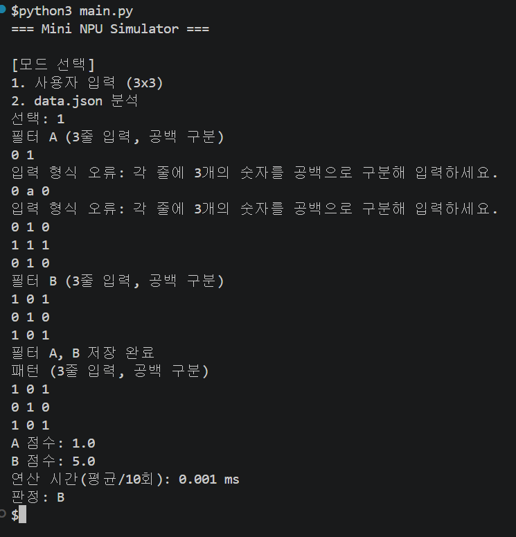
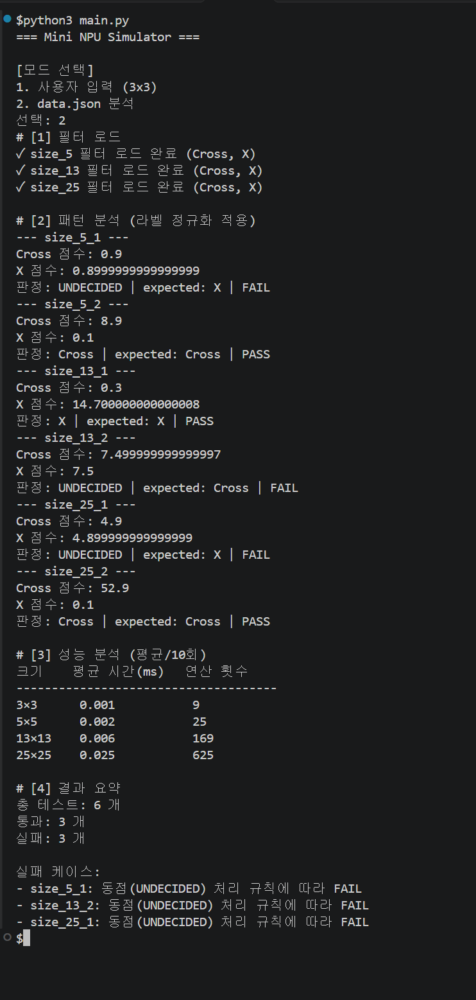
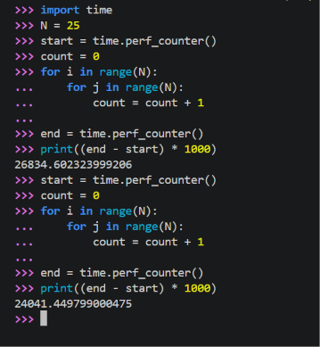
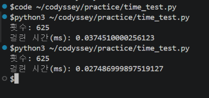
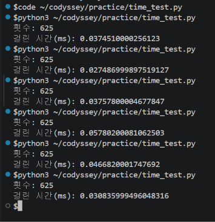

# Mini NPU Simulator (mission3)

> 숫자 표(패턴)와 기준 표(필터)를 같은 자리끼리 곱하고 모두 더하는 **MAC 연산**을 반복문으로 직접 구현해, 십자가(Cross)와 X를 판별하는 콘솔 프로그램입니다.

## 목차
1. [개요](#1-개요)
2. [실행 환경](#2-실행-환경)
3. [실행 방법](#3-실행-방법)
4. [구현 요약](#4-구현-요약)
5. [실행 화면](#5-실행-화면)
6. [결과 리포트](#6-결과-리포트)
7. [수행 체크리스트](#7-수행-체크리스트)
8. [트러블슈팅](#8-트러블슈팅)
9. [검증 방법](#9-검증-방법)
10. [보너스](#10-보너스)
11. [제출 정보](#11-제출-정보)

---

## 1. 개요

| 항목 | 내용 |
|---|---|
| 과제 | AI가 계산하는 방식을 흉내 내는 작은 계산기 만들기 (Mini NPU Simulator) |
| 파일 | `main.py` (프로그램), `data.json` (과제 제공 데이터), `README.md` |
| 모드 1 | 3×3 필터 A·B와 패턴을 직접 입력 → MAC 점수, 연산 시간(ms), 판정(A / B / 판정 불가) |
| 모드 2 | `data.json`의 5×5·13×13·25×25 필터와 패턴 6개를 불러와 판정(Cross / X / UNDECIDED) → expected와 비교(PASS/FAIL) → 성능 표 → 결과 요약 |
| 사용 도구 | Python 표준 라이브러리 `json`, `time`만 사용 (NumPy 등 외부 라이브러리 없음) |
| 보너스 | 패턴 생성기(N을 넣으면 N×N 십자가·X 자동 생성) → 성능 분석에 재활용 |

## 2. 실행 환경

| 항목 | 내용 |
|---|---|
| OS | Windows + WSL(Ubuntu) |
| Python | 3.14.4 (`python3`) |
| 편집기 | VS Code (WSL 연결) |
| 외부 라이브러리 | 없음 |

## 3. 실행 방법

```bash
git clone https://github.com/jjin1990/mission3.git
cd mission3
python3 main.py
```

- 실행하면 모드를 묻습니다. `1` = 사용자 입력(3×3), `2` = data.json 분석. 그 밖의 입력은 다시 묻습니다.
- **모드 1**: 필터 A, 필터 B, 패턴을 각각 3줄씩, 한 줄에 숫자 3개를 공백으로 구분해 입력합니다.
- **모드 2**: `data.json`을 **`main.py`와 같은 폴더**에 두고, 그 폴더에서 실행합니다. (파일을 `"data.json"`이라는 상대 경로로 열기 때문에, 명령을 친 폴더에서 찾습니다.)

## 4. 구현 요약

### 함수 구성

| 함수 | 하는 일 |
|---|---|
| `mac(pattern, filter_)` | 이중 for로 같은 자리끼리 곱해 `total`에 누적 → 점수 반환. 크기는 `len(pattern)`으로 자동 |
| `judge(score_a, score_b, name_a, name_b)` | 차이가 `EPSILON`보다 작으면 `"UNDECIDED"`, 아니면 더 큰 쪽 이름 반환 |
| `select_mode()` | `"1"` 또는 `"2"`만 받고 나머지는 다시 묻기 |
| `read_row(n)` / `read_matrix(n, title)` | 한 줄 입력 → `split()` → 개수 검사 → `float()` 변환(실패 시 다시) / n줄을 모아 2차원 리스트로 |
| `measure_ms(pattern, filter_, repeat=10)` | `time.perf_counter()`로 MAC만 10번 재서 평균 ms |
| `run_mode1()` | 모드 1 흐름 |
| `load_data`, `normalize_label`, `size_from_key`, `is_square` | json 읽기 / 라벨 표준화 / `size_13_1` → 13 / n×n 검사 |
| `make_cross(n)`, `make_x(n)` | 보너스: 패턴 생성기 |
| `print_performance(filters)` / `run_mode2()` | 성능 표 / 모드 2 흐름 |

### MAC 연산

```python
total = 0                                            # 반복문 위에서 한 번만 0
for i in range(n):                                   # 줄
    for j in range(n):                               # 칸
        total = total + pattern[i][j] * filter_[i][j]
```

- 0과 1만 있으면 점수는 "패턴과 필터가 **같이 칠해진 칸 수**"가 됩니다. 그래서 점수가 큰 필터가 더 비슷한 모양입니다.
- `total = 0`을 반복문 **안**에 두면 칸마다 0으로 비워져 마지막 칸의 곱만 남습니다(직접 실험: X·X에서 5가 아니라 1). 그래서 반복문 **위**에 둡니다.

### 라벨 정규화

| 원래 표기 | 어디에 | 표준 라벨 |
|---|---|---|
| `"+"` | patterns의 expected | `Cross` |
| `"x"` | patterns의 expected | `X` |
| `"cross"` | filters의 키 | `Cross` |
| `"x"` | filters의 키 | `X` |

- `normalize_label`은 `strip().lower()`로 공백·대소문자를 맞춘 뒤 표준 라벨로 바꿉니다.
- **왜?** 데이터 안에서 같은 뜻을 `+`와 `cross`처럼 다르게 쓰고 있어서, 그대로 비교하면 `"Cross" == "+"`가 False가 되어 맞게 판정해도 FAIL이 됩니다. 프로그램 안에서는 Cross/X 두 가지만 쓰고, 출력과 PASS/FAIL 비교도 이 기준으로 합니다.

### 동점 처리 정책 (epsilon)

```python
EPSILON = 1e-9                                       # 0.000000001
if abs(score_a - score_b) < EPSILON:                 # 차이의 크기가 아주 작으면
    return "UNDECIDED"
```

- 컴퓨터는 소수를 2진수로 끊어서 저장하므로 `0.1 + 0.2`가 `0.30000000000000004`가 되고 `0.1 + 0.2 == 0.3`은 `False`입니다(직접 확인). 그래서 `==` 대신 "차이가 허용오차보다 작으면 같다"로 비교합니다.
- `abs`를 빼면 `1 - 5 = -4`도 `1e-9`보다 작아 동점이 되어 버립니다. 동점 검사(크기)에는 `abs`, 누가 큰지(방향)는 `>`로 따로 봅니다.
- `1e-9`를 고른 이유: 계산 오차(소수점 아래 15~16번째 자리)보다는 훨씬 크고, 실제 점수 차이(0.1 이상)보다는 훨씬 작습니다. 파이썬 `math.isclose`의 기본 허용오차도 `1e-09`입니다.

### 시간 측정

- `measure_ms`는 스톱워치(`perf_counter`)를 **MAC 호출 바로 앞뒤**에만 둡니다. 입력·출력·파일 읽기 시간은 넣지 않습니다.
- 한 번만 재면 숫자가 흔들려서 **10번 평균**을 냅니다(아래 트러블슈팅 8-1, 8-2).

## 5. 실행 화면

### 모드 1 (잘못된 입력 → 재입력 → 판정)


*`0 1`(숫자 2개)과 `0 a 0`(숫자 아님)을 넣으면 안내 후 다시 묻고, 십자가 필터 A / X 필터 B / X 패턴으로 A 1.0, B 5.0, 판정 B가 나옵니다.*

### 모드 2 (data.json 분석)


*필터 3종 로드 → 패턴 6개 판정·PASS/FAIL → 성능 표 → 결과 요약(총 6 / 통과 3 / 실패 3).*

## 6. 결과 리포트

### 6-1. 모드 2 결과

| 케이스 | Cross 점수 | X 점수 | 판정 | expected | 결과 |
|---|---|---|---|---|---|
| size_5_1 | 0.9 | 0.8999999999999999 | UNDECIDED | X | FAIL |
| size_5_2 | 8.9 | 0.1 | Cross | Cross | PASS |
| size_13_1 | 0.3 | 14.700000000000008 | X | X | PASS |
| size_13_2 | 7.499999999999997 | 7.5 | UNDECIDED | Cross | FAIL |
| size_25_1 | 4.9 | 4.899999999999999 | UNDECIDED | X | FAIL |
| size_25_2 | 52.9 | 0.1 | Cross | Cross | PASS |

### 6-2. 실패 원인 분석

1. 실패 3개(size_5_1, size_13_2, size_25_1)는 **모두 판정이 UNDECIDED**라서 expected(X 또는 Cross)와 달라 FAIL이 되었습니다.
2. 세 케이스 모두 두 점수의 차이가 `0.000000000000004`보다 작아서(소수점 아래 15~16번째 자리), **부동소수점 오차만큼만** 다릅니다. 실제로는 같은 점수입니다.
3. 그래서 원인을 세 가지로 나눠 보면 **수치 비교 문제**에 해당합니다.
   - 데이터/스키마 문제가 아님: 키 규칙(`size_N_idx`)과 라벨(`+`, `x`)은 정규화로 모두 해석되었고, 크기 불일치도 없었습니다(통과 3개도 같은 경로로 처리됨).
   - 로직 문제가 아님: MAC은 모드 1 예시(A 1.0, B 5.0)와 손 계산이 일치하고, 통과 케이스의 판정도 맞습니다.
4. 이 세 케이스는 필터 값(예: size_5에서 십자가 필터 가운데 `0.9` 한 칸 vs X 필터 `0.1` 아홉 칸 → 둘 다 0.9)이 **두 점수가 똑같아지도록** 맞춰져 있습니다. 즉 "부동소수점 오차가 판정을 어떻게 흔드는지"를 확인하라는 데이터로 보입니다.
5. 만약 `>`로만 비교했다면 0.9 > 0.8999999999999999라서 size_5_1은 Cross로 판정되었을 것이고, 이건 **진짜 차이가 아니라 저장 오차가 판정을 정한 것**입니다(출력된 점수로 본 해석). 같은 이유로 size_13_2는 X, size_25_1은 Cross가 되어 결국 셋 다 FAIL이고, 그 FAIL의 이유는 우연입니다.
6. epsilon 정책은 이런 "오차로 인한 우연한 승패"를 막고, 같은 점수는 **판정 불가**로 정직하게 표시합니다. 과제의 판정 규칙(동점은 UNDECIDED, expected와 다르면 FAIL)을 그대로 따랐기 때문에 이 FAIL은 **정책에 따른 정상 결과**라고 판단했습니다.
7. 실패 0을 만들려고 동점일 때 expected를 따라가게 바꾸는 것은 정답을 보고 판정을 고치는 것이라 하지 않았습니다. 개선한다면 동점일 때 판정 대신 "재검사 필요"로 따로 세는 방법을 생각해 볼 수 있습니다(실습하지 않음).

### 6-3. 성능 분석과 O(N²)

| 크기 | 평균 시간(ms, 10회) | 연산 횟수(N²) |
|---|---|---|
| 3×3 | 0.001 | 9 |
| 5×5 | 0.002 | 25 |
| 13×13 | 0.006 | 169 |
| 25×25 | 0.025 | 625 |

1. MAC은 N×N 칸을 한 번씩 지나며 곱셈·덧셈을 하므로 연산 횟수가 **N²**입니다. 이중 for에서 바깥 반복 N번마다 안쪽이 N번 돌기 때문입니다.
2. 13×13 → 25×25에서 연산 횟수는 169 → 625로 **약 3.7배**, 시간은 0.006 → 0.025ms로 **약 4.2배** 늘었습니다. 크기가 커질수록 시간이 N²과 비슷한 비율로 늘어나는 것을 확인했습니다. 이것이 **O(N²)**의 근거입니다.
3. 3×3과 5×5는 시간이 0.001~0.002ms로 너무 작아서, 소수점 3자리 반올림과 함수 호출 같은 고정 시간 때문에 N² 비율이 그대로 보이지 않습니다. 크기가 클수록 비율이 잘 드러납니다.
4. 이중 for는 칸을 **한 번에 하나씩 차례로**(직렬) 계산합니다. 실제 AI는 수백×수백 필터를 수천 개 쓰므로 이 방식으로는 감당하기 어렵고, 그래서 같은 계산을 한꺼번에(병렬) 처리하는 NPU가 필요합니다.
5. 같은 코드도 잴 때마다 시간이 달라서(트러블슈팅 8-2), 10회 평균을 낸 값으로 비교했습니다.

## 7. 수행 체크리스트

| 요구 사항 | 결과 |
|---|---|
| n×n 2차원 리스트 저장, 특정 위치 읽기·쓰기 (3·5·13·25) | ✅ |
| 모드 1: 필터 A·B, 패턴 한 줄씩 입력 + 행·열 개수·숫자 검증 후 재입력 | ✅ |
| 모드 2: filters·patterns 로드, 키에서 N 추출, 크기 검증(불일치 시 케이스 FAIL) | ✅ |
| 라벨 정규화 (`+`·`cross` → Cross, `x` → X) | ✅ |
| MAC 반복문 직접 구현 (외부 라이브러리 없음) | ✅ |
| epsilon 기반 동점 처리 | ✅ |
| 크기별 10회 평균 시간 + N² 표 | ✅ |
| 결과 요약 (총·통과·실패 + 실패 사유) | ✅ |
| 보너스: 패턴 생성기 | ✅ |

## 8. 트러블슈팅

### 8-1. 대화창에서 시간을 쟀더니 27초가 나옴
- **상황**: `python3` 대화창(`>>>`)에서 25×25 반복문 시간을 재니 26834ms, 24041ms가 나왔습니다.
- **원인**: 대화창은 줄을 칠 때마다 바로 실행되므로, `start` 다음부터 반복문을 **타이핑하는 시간**까지 들어갔습니다.
- **해결**: 코드를 파일에 써서 한 번에 실행했더니 0.0375ms로, 약 70만 배 차이가 났습니다.
- **배운 점**: 스톱워치는 계산 바로 앞뒤에만 둡니다. 과제가 "I/O 시간을 제외하라"고 한 이유를 직접 확인했습니다.


*대화창에서 잰 결과(타이핑 시간 포함).*


*같은 계산을 파일로 실행한 결과.*

### 8-2. 두 번째 실행부터 빨라질 거라고 예상
- **상황**: 같은 파일을 두 번 실행하니 두 번째가 더 빨라서 "한 번 실행한 코드라 빨라진다"고 예상했습니다.
- **확인**: 6번 실행하니 0.0375 / 0.0275 / 0.0376 / 0.0578 / 0.0467 / 0.0308ms로 커졌다 작아졌다 했습니다. 예상이 틀렸습니다.
- **원인**: 컴퓨터가 다른 프로그램과 함께 돌아서 매번 조금씩 다르게 처리됩니다.
- **배운 점**: 그래서 한 번이 아니라 **10번 평균**을 냅니다.


*같은 코드 6번 실행 결과.*

### 8-3. 그 밖의 문제

| 상황 | 원인 | 해결 |
|---|---|---|
| 메뉴에서 1을 쳐도 계속 "1 또는 2를 입력하세요" | `input().split()`은 `["1"]`(리스트)이라 `"1"`과 같지 않음 | `strip()`으로 변경 (앞뒤 공백만 지우고 글자 유지) |
| `judge(1, 5)`가 UNDECIDED | 동점 조건에 `abs`가 빠져 `-4 < 1e-9`가 True | `abs(score_a - score_b)` |
| `judge`의 판정을 다시 쓸 수 없음 | `print`만 하고 `return`을 안 함 | `return` |
| `NameError: name 'pattern' is not defined` | 대화창을 새로 열면 변수가 사라짐 | 변수 정의부터 다시 |
| `SyntaxError: expected ':'` | `except (…)` 끝 콜론 빠짐 | `:` 추가 |
| 코드를 고쳤는데 옛 결과가 나옴 | 저장 안 하고 실행 | 실행 전 탭 ● 확인, Ctrl+S |
| `git add … data.json\` 뒤 `>`만 나옴 | 줄 끝 `\`는 "다음 줄에 이어 쓴다"는 뜻 | Ctrl+C로 취소 후 다시 |
| `git remote add origin`에서 사용법만 나옴 | 주소(url)를 빼고 Enter | 주소까지 한 줄로 |

## 9. 검증 방법

| 검증 | 방법 | 결과 |
|---|---|---|
| MAC | X·X → 5, X·십자가 → 1 | ✅ |
| 누적 위치 | `total = 0`을 반복문 안에 둔 버전 → 1 (틀린 결과 확인) | ✅ |
| 동점 | `judge(0.9, 0.8999999999999999)` → UNDECIDED, `judge(3, 5)` → B | ✅ |
| 메뉴 | `abc`, `3`, 빈칸 → 다시 묻기 | ✅ |
| 모드 1 입력 | `0 1`(개수), `0 a 0`(숫자 아님), `010`(띄어쓰기 없음) → 안내 후 재입력 | ✅ |
| 모드 2 | 6개 케이스 PASS/FAIL과 요약(6/3/3) 일치 | ✅ |
| 보너스 | `make_cross(13)`, `make_x(25)`가 data.json의 size_13_2, size_25_1 입력과 같음 | ✅ |

## 10. 보너스

**패턴 생성기** (`make_cross(n)`, `make_x(n)`)

- 십자가: 가운데 번호 `mid = n // 2`의 줄 또는 칸이면 1 (`i == mid or j == mid`)
- X: 두 대각선이면 1 (`i == j or i + j == n - 1`)
- 생성한 13×13 십자가와 25×25 X는 data.json의 패턴과 칸 하나까지 같았습니다.
- **재활용**: 성능 분석 표에서 data.json 없이도 3×3을 포함한 모든 크기를 같은 조건(X 패턴 × 십자가 필터)으로 측정하는 데 사용했습니다.

## 11. 제출 정보

| 제출물 | 위치 |
|---|---|
| GitHub 저장소 | https://github.com/jjin1990/mission3 (Public, `main`) |
| 메인 실행 파일 | `main.py` |
| README (실행 방법 + 결과 리포트) | 이 문서, [3. 실행 방법](#3-실행-방법), [6. 결과 리포트](#6-결과-리포트) |
| 실행 사진 | `evidence/` 폴더 |zzzz